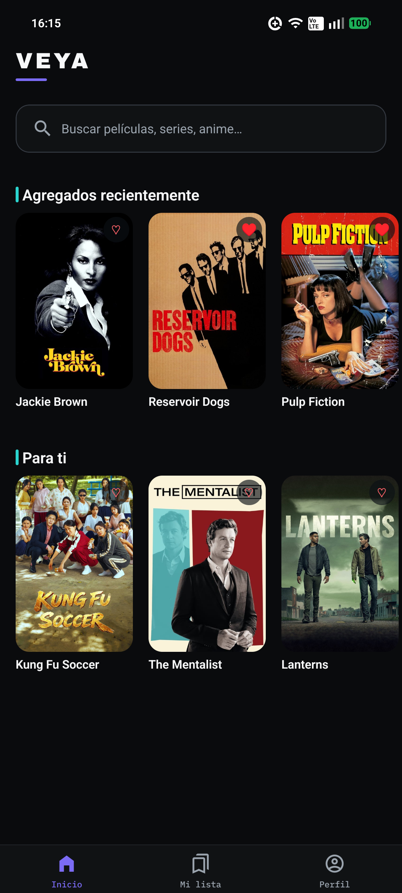
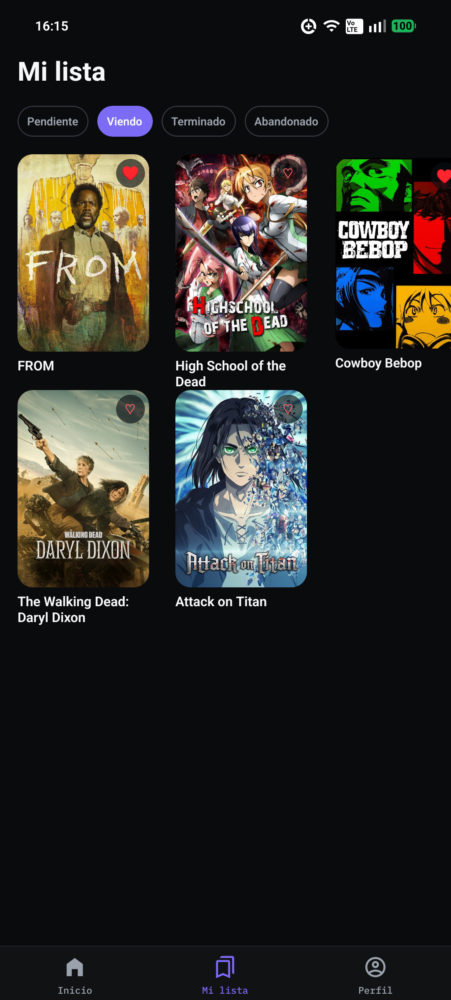
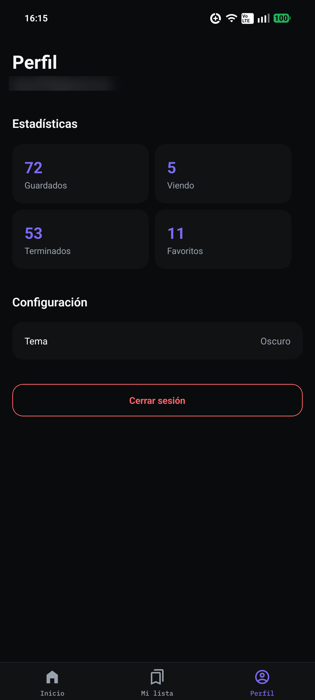

# Veya 🎬

App Android para buscar películas, series y anime en un solo lugar, guardar tu lista y trackear tu progreso.

<table align="center">
  <tr>
    <td align="center">
       
      <b>Home</b>
    </td>
    <td align="center">
       
      <b>Mi lista</b>
    </td>
    <td align="center">
       
      <b>Perfil</b>
    </td>
  </tr>
</table>

## Por qué existe

Películas y series por un lado, anime por otro — la mayoría de catálogos solo cubren uno de los dos. Veya junta ambos mundos en una sola búsqueda y una sola lista: guardas lo que quieres ver, marcas tu progreso por temporada/episodio, y recibes recomendaciones basadas en lo que de verdad te gustó, no en lo que está de moda.

## Features

- 🔍 Búsqueda unificada de películas, series y anime
- 📌 Guarda contenido con estado (viendo, completado, pendiente), favoritos y calificación
- 📺 "Continuar viendo" con progreso de temporada y episodio
- 🎯 Recomendaciones basadas en tus propios géneros, favoritos y calificaciones
- 🔥 Contenido en tendencia

## Stack

React Native · TypeScript · Zustand · React Query

> API en NestJS + PostgreSQL: **[veya_backend](https://github.com/Hector0122/veya_backend)**

## Licencia

MIT — ver [LICENSE](LICENSE)
